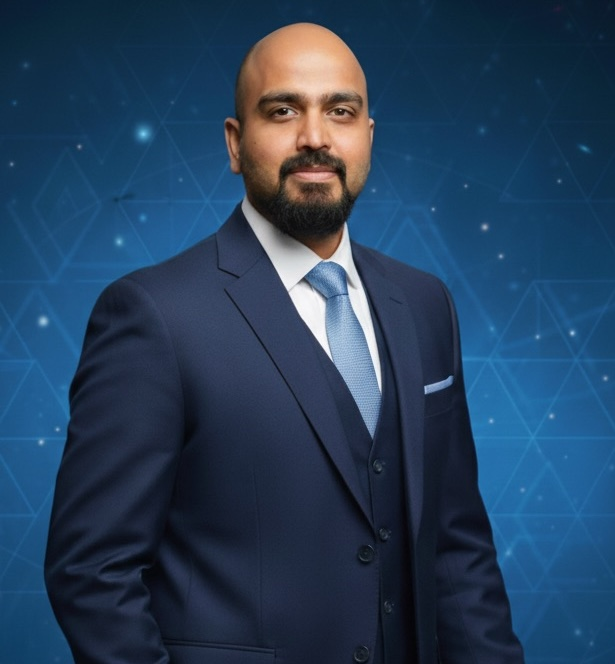

---
hide:
  - navigation
  - toc
title: Dr. Nirmal Parmar - AI Researcher & Machine Gnostics Founder
description: AI researcher and Director of Data Analytics at Novartis. Founder of Machine Gnostics, the world's first non-statistical ML library for small data analysis.
keywords: non-statistical ML, small data AI, Machine Gnostics, thermal engineering, AI researcher
---
<section class="home-hero" markdown>

Director, Data Analytics & AI · Novartis

# Dr. Nirmal Parmar

Research scientist and AI innovator bridging thermal engineering and non-statistical artificial intelligence. Founder of [Machine Gnostics](https://www.machinegnostics.com/), the world's first non-statistical ML library.

[Get in touch](contact.md){ .md-button .md-button--primary }
[Explore Machine Gnostics](ai-mg.md){ .md-button }

{ .home-photo }

</section>

<section class="home-section home-feature" markdown>

Machine Gnostics

## Redesigning the Mathematical Core of AI

Most AI relies on large datasets and statistical assumptions. [Machine Gnostics](ai-mg.md) encodes geometry, physics, and entropy directly into algorithms, delivering reliable results even from small, noisy, real-world data.

[Explore Machine Gnostics :material-arrow-right:](ai-mg.md){ .home-link }

</section>

<section class="home-section" markdown>

## How I can help

:material-flask-outline:{ .home-service-icon }

### Research collaboration

Joint research with universities and institutes on AI, non-statistical methods, and thermal engineering applications.

[Let's connect](contact.md){ .home-link }

:material-briefcase-outline:{ .home-service-icon }

### Industry consultancy

Enterprise AI strategy, digital transformation, and small-data AI solutions that work on real-world industrial data.

[Let's connect](contact.md){ .home-link }

:material-microphone-outline:{ .home-service-icon }

### Speaking & mentorship

Keynotes, PhD/postdoc supervision, and career coaching at the intersection of AI and engineering.

[Let's connect](contact.md){ .home-link }

</section>

<section class="home-section" markdown>

## Connect

[:fontawesome-brands-linkedin: LinkedIn](https://www.linkedin.com/in/nirmal-parmar-phd-3a440037){ target="_blank" rel="noopener" }
[:fontawesome-solid-graduation-cap: Google Scholar](https://scholar.google.co.in/citations?user=cF90K6cAAAAJ&hl=en){ target="_blank" rel="noopener" }
[:fontawesome-brands-researchgate: ResearchGate](https://www.researchgate.net/profile/Nirmal-Parmar){ target="_blank" rel="noopener" }
[:fontawesome-brands-orcid: ORCID](https://orcid.org/0000-0003-4603-1550){ target="_blank" rel="noopener" }
[:fontawesome-brands-github: GitHub](https://github.com/nirmalparmarphd){ target="_blank" rel="noopener" }
[:fontawesome-brands-medium: Medium](https://medium.com/@nirmalparmarphd){ target="_blank" rel="noopener" }
[:fontawesome-solid-seedling: Machine Gnostics](https://www.machinegnostics.com/){ target="_blank" rel="noopener" }

</section>

<section class="home-section home-collab" markdown>

## Open to collaboration

Dr. Parmar welcomes collaboration with forward-thinking organizations, research institutions, and individual researchers who are ready to explore the transformative potential of non-statistical AI in engineering and business applications.

[Get in touch](contact.md){ .md-button .md-button--primary }

</section>

<blockquote class="home-quote" markdown>
*"Redesigning the Mathematical Core of AI."*

— Dr. Nirmal Parmar
</blockquote>
